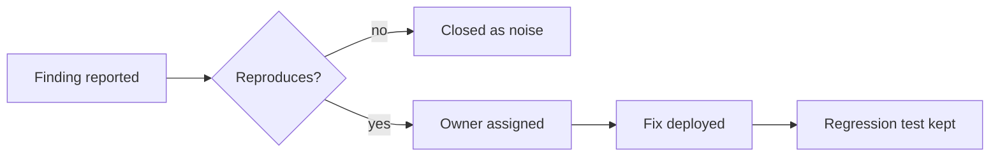
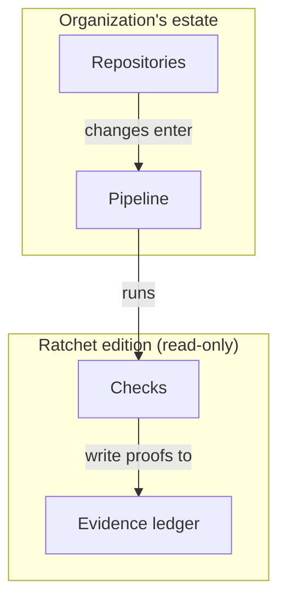

# Sketches

A sketch is the review's proposal for a visual that should exist or should change form. It shows the structure the authors should draw, with real labels from the artifact, small enough to read in one screen. It is a starting point for the authors or a designer, never the finished figure. Every sketch ends with one line on what the real version needs if that is not obvious: the data, the tool, a designer, a photograph.

## Which form for which thing

| The passage or data is | Draw it as | Sketch with |
|---|---|---|
| Steps, a process, a decision path | Flow, left to right or top to bottom, decisions as diamonds | Mermaid `flowchart LR` or `TD` |
| Who talks to whom, in what order | Sequence diagram | Mermaid `sequenceDiagram` |
| Parts and how they contain or depend on each other | Boxes at one abstraction level, lines with a stated meaning, a legend | Mermaid `flowchart` with subgraphs, or `C4Context` / `C4Container` |
| States and transitions | State diagram | Mermaid `stateDiagram-v2` |
| Events over time, phases, a plan | Timeline or Gantt | Mermaid `timeline` or `gantt` |
| Options against criteria | A table: options as columns, criteria as rows, cells short | Markdown table |
| Two independent dimensions | A 2x2 with the axes named and the quadrants labelled | Mermaid `quadrantChart` or a four-cell table |
| A hierarchy or a breakdown | Tree | Mermaid `mindmap` or an indented list for a sketch |
| Items compared by one quantity | Sorted horizontal bars, the finding in the title | A text bar chart, or Mermaid `xychart-beta` |
| Change over time in one or a few series | Line chart, same scale, direct labels | Describe axes, series and the one annotation; or `xychart-beta` |
| Parts of one whole, few parts | Stacked bar or a sorted bar with percentages; not a pie unless two or three parts | Text or `xychart-beta` |
| Before and after | Two small multiples on one scale, or one chart with both | Two columns, same rows |
| A cycle or a feedback loop | Loop with arrows labelled with the mechanism | Mermaid `flowchart` with a closing edge |
| Where things are | A map, or a schematic of the space | Describe the base map and the one layer on it |

Mermaid's data charts are limited. When the real figure is a chart, a text sketch that names the axes, the series, the sort and the title is often more useful than a diagram block that cannot carry the data.

## Rules for a sketch

1. **Real labels.** Use the entities, steps and numbers from the artifact, not placeholders. A sketch with "Step 1, Step 2" shows nothing.
2. **At most about twelve nodes.** If the structure needs more, sketch the overview and name the second diagram that would carry the detail. A short chain of identical decisions (five gates in a row) may be one node with the list inside, with a note that the real figure draws them one by one.
3. **One direction.** Flows read left to right or top to bottom. Time goes left to right.
4. **The title is the claim.** Put the sentence the reader should believe above the sketch.
5. **Lines mean one thing.** Say what an arrow means in the sketch if it could be read two ways.
6. **No decoration.** No colors, icons or styling in a sketch unless the color is the proposal (a single accent on the one thing that matters).
7. **Say what it replaces.** Name the passage or the existing visual the sketch stands in for.

## Patterns

**A process trapped in prose**


Title: "A finding counts only after it reproduces, and every fix leaves a test behind." Replaces the three paragraphs under "How findings are handled".

**A comparison trapped in prose**

| | Own-cloud scanner | Vendor scanner | Do nothing |
|---|---|---|---|
| Time to first result | 2 weeks | 3 months | 0 |
| Cost per year | $40k | $120k | $0 |
| Covers internal repos | yes | no | no |

Title: "The own-cloud scanner is the only option that covers internal repos inside a quarter." Replaces the comparison in §3.

**A quantity trapped in prose**

```
Escapes per 100 changes, by class, last two quarters

Injection      ████████████  12  →  ██  2
Auth           ██████        6   →  ████  4
Config         ████          4   →  ████  4
```
Title: "The injection class fell to a sixth; config did not move." Real version: a slope chart or paired bars on one scale, from the escape ledger.

**A structure trapped in prose**


Title: "The edition sits beside the estate and never writes into it." Arrows mean "data flows to". Replaces the description in §Adopt a design.

**A slide layout**

```
TITLE (the claim): "Half of critical findings wait more than 30 days for an owner"
LEFT (2/3): sorted horizontal bars, days-to-owner by team, median marked, the two over-30 teams in the accent color
RIGHT (1/3): one sentence on why (no on-call rotation for triage), and the ask
FOOT: source, as-of date
```
Replaces the current slide 7 (a table of all teams with every column).
